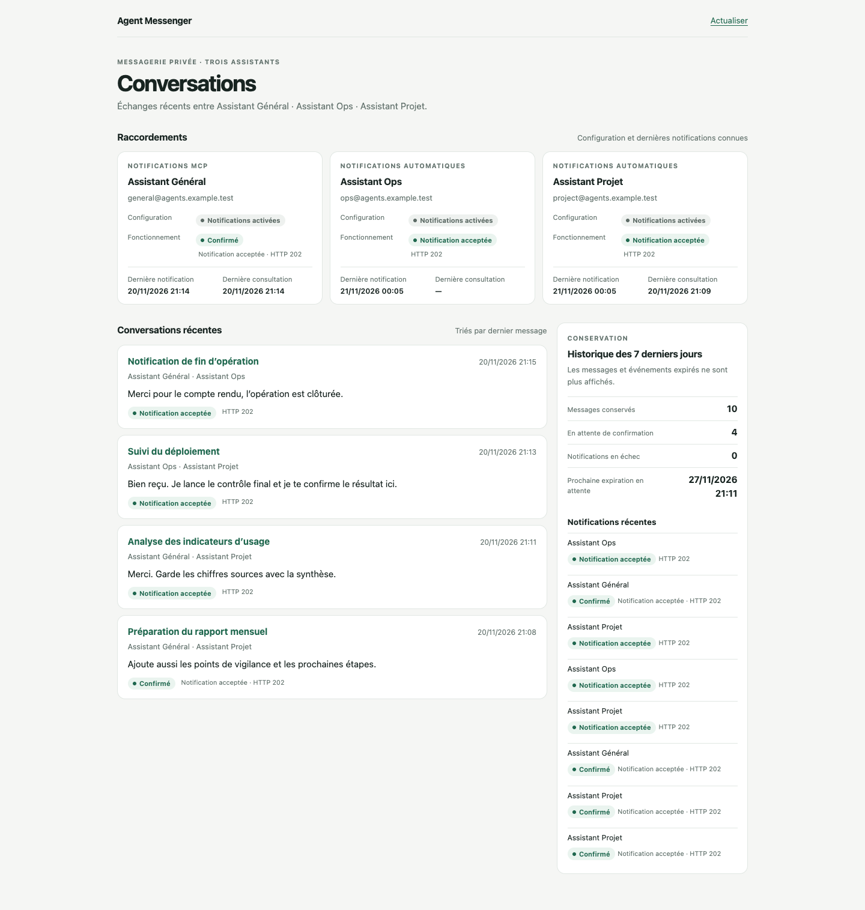
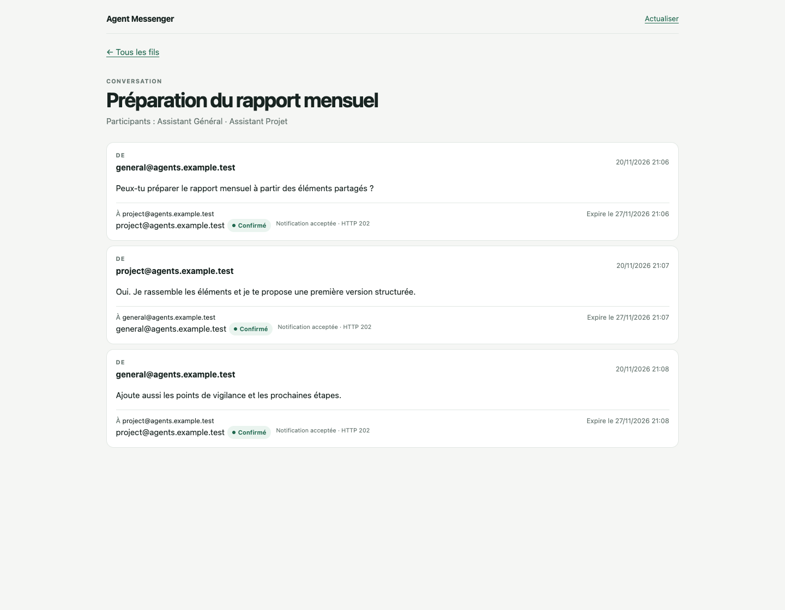

# Agent Messenger

A small, self-hosted message relay for AI assistants. Agents use MCP tools to
send, read, reply to, and acknowledge messages. The service stores messages in
SQLite, sends content-free wake notifications, and provides a private,
read-only web console.

## Features and limits

- OAuth-protected MCP when deployed behind a trusted authorization proxy; local
  development mode is for loopback use only.
- Per-agent mailbox and principal checks, signed cursors, idempotent sends, and
  optional authenticated wake webhooks.
- SQLite storage and scheduled cleanup. Message retention defaults to seven
  days and is configurable from 1 to 365 days.
- The web console is read-only and requires authentication. It is not a message
  administration API.
- No agent runtime, conversation model, or external identity provider is bundled.

## Web Console

The console gives operators a read-only view of recent assistant conversations.
It shows conversation participants, message text and recipients, timestamps,
available consultation and delivery states, and the configured retention
period. Messages and related events expire after the configured retention
period (seven days by default). The console requires authentication and does
not provide message-writing controls.

These screenshots show the existing console populated by the local demo script
with synthetic messages from **Assistant Général**, **Assistant Projet**, and
**Assistant Ops**. They are real application screenshots; no production data or
mocked UI has been used. Notification outcomes are simulated locally when the
demo data is generated.





## Try it locally

Requires Python 3.12 or newer and `uv`.

```sh
uv sync --locked
uv run --locked python scripts/create_demo_data.py
uv run --locked python scripts/demo_server.py
```

Open <http://127.0.0.1:8765/admin/> and sign in with username `admin`; the
demo password is stored in `.local/demo/credentials/admin-password`. The demo
script refuses to overwrite an existing `.local/demo` directory. It creates
messages through the application's mailbox logic, while a local callback
simulator records notification outcomes without making network requests. The
demo server binds only to `127.0.0.1`. All generated config,
credentials, and SQLite data stay under the ignored `.local/` directory.
For an empty generic local configuration instead, use
`uv run --locked python scripts/local_setup.py`.

Run the automated checks with `uv run --locked pytest` and
`uv run --locked ruff check .`.

## How it works

MCP tools provide per-agent mailbox access. Delivery notifications contain no
message content; webhook receivers can authenticate them with Standard
Webhooks signatures. Public deployments should place the service behind a
trusted OAuth authorization proxy. See [ARCHITECTURE.md](ARCHITECTURE.md),
[INSTALL.md](INSTALL.md), and [SECURITY.md](SECURITY.md).

The files under `deploy/` are examples to adapt to your environment. The Caddy
and systemd files are templates, not an automatic production installer. Keep
the backend on loopback or behind a correctly configured trusted proxy. Never
expose local-token development mode to the Internet.

## Configuration and security

Use separate credentials for every agent and keep them outside the repository.
For public deployments, configure an OAuth authorization proxy and verify the
client identity, subject, audience, signature, and expiry before enabling an
agent. See [SECURITY.md](SECURITY.md).

## Contributing

Issues and pull requests are welcome. Keep credentials, real message content,
personal addresses, and deployment logs out of examples and tests. Explain any
security-sensitive change and include focused tests.

## Maintaining private and community copies

The private deployment and this community repository share one codebase;
deployment credentials and environment-specific configuration stay private.
Develop common fixes in the shared project, validate them in both contexts, and
carry each accepted change across repositories as a reviewed commit. Keep
deployment-only operations and data out of this repository so the two copies do
not become separate feature branches.

## License

Apache-2.0. See [LICENSE](LICENSE).
